<p align="center">
  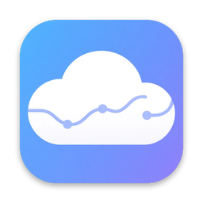
</p>

<h1 align="center">Kumo</h1>

<p align="center">A fast, native desktop client for mihomo (Clash) — one switch to connect, a full dashboard to watch.</p>

<p align="center">
  <a href="https://github.com/kumo-app/kumo/releases/latest"></a>
  
  
  <a href="LICENSE"></a>
  <a href="https://github.com/kumo-app/kumo/actions/workflows/release.yml"></a>
  <a href="https://github.com/kumo-app/kumo/releases"></a>
</p>

<p align="center"><b>English</b> | <a href="README.zh-CN.md">简体中文</a></p>

## Highlights

- **Works out of the box.** Every package bundles the
  [mihomo](https://github.com/MetaCubeX/mihomo) core. Kumo runs it with its
  own data directory, a free controller port and a random secret, and stops
  it when you quit.
- **One switch to connect.** Turn the system proxy on from Home or the tray
  (macOS, Windows, GNOME on Linux). Your previous proxy settings are saved
  and restored when you disconnect or quit — and repaired at the next launch
  if Kumo ever crashes.
- **A real dashboard.** Live upload and download charts, core memory, open
  connections, session totals, the node in use with its latency, and the
  active subscription with usage and expiry.
- **Nodes at a glance.** Every proxy group as a card, color-coded latency,
  test all, sort by latency, and one click to switch to the fastest node.
- **Statistics.** Traffic by day and month, by app, node and proxy group,
  kept on your computer as a small file (90 days, 24 months).
- **Node monitor and tests.** Background latency checks give each node its
  uptime, p95, jitter and outages for the session; test a node's download
  speed or UDP support without changing your choice.
- **Global shortcuts.** Toggle the system proxy or Enhanced Mode, switch
  mode, show or hide Kumo from anywhere (off until you set them).
- **Subscriptions.** Add by link (auto update every 6/12/24 h) or import a
  local YAML file; switching reloads the core without restarting it.
- **Live activity.** Rules, connections (with chains, rules and traffic, each
  closable) and logs, all filterable.
- **Native and light.** Pure Go on [MyGo](https://github.com/egoist/mygo) —
  no Electron, no webview. Light and dark themes, six accent colors,
  Traditional Chinese and English.

## Screenshots

| | |
|---|---|
| 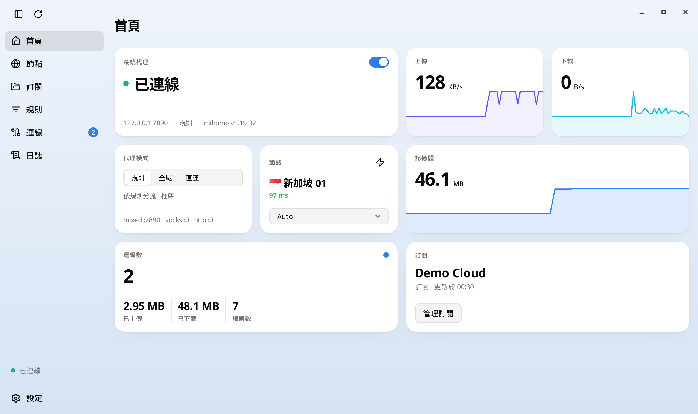<br>**Home** — connect switch, live traffic, mode, node and latency | 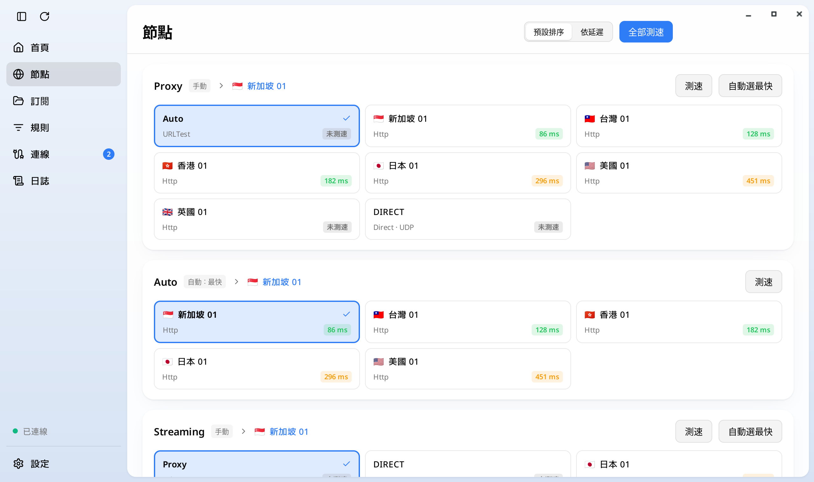<br>**Nodes** — groups, latencies, fastest in one click |
| 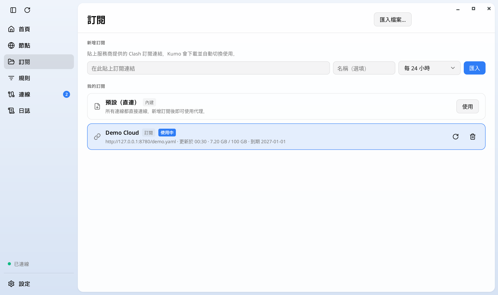<br>**Subscriptions** — add by link, usage, expiry, update | 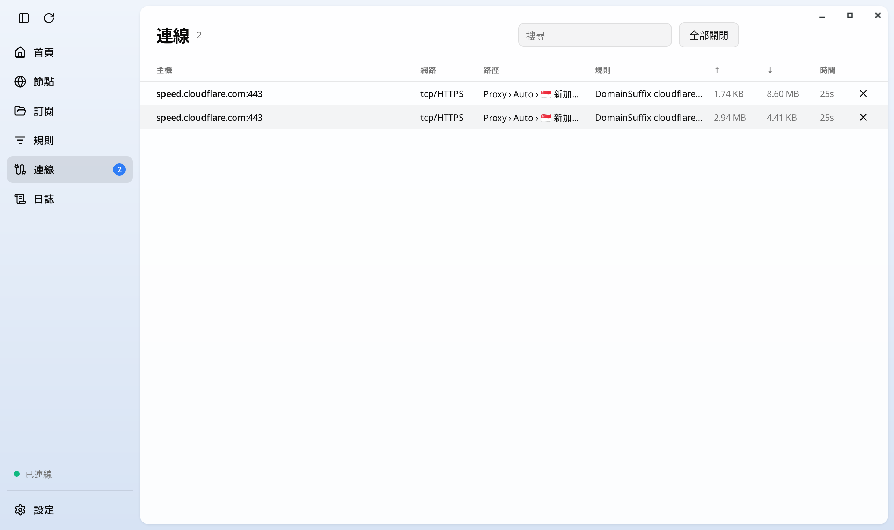<br>**Connections** — live routes, rules and traffic |
| 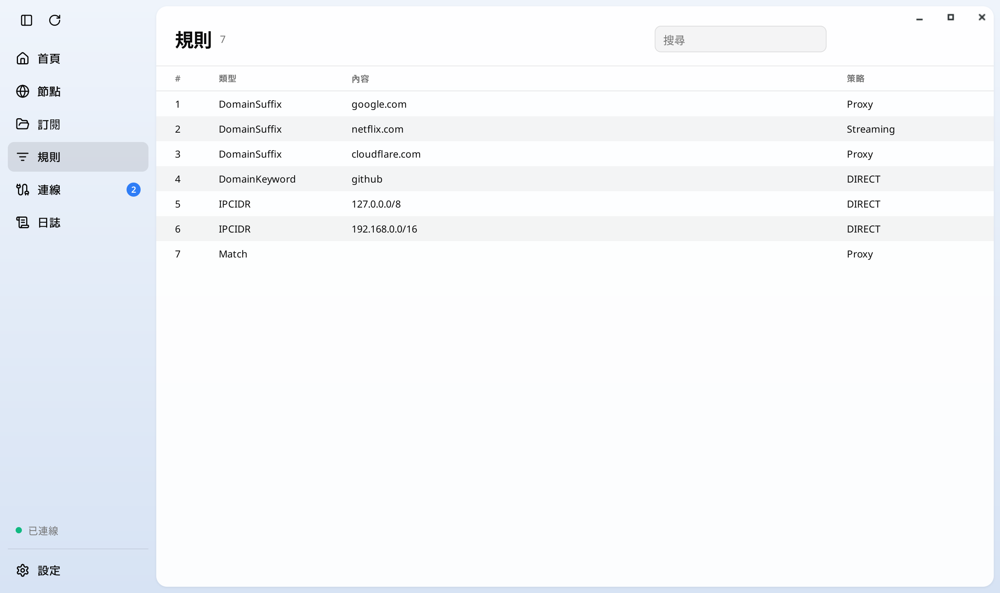<br>**Rules** — the core's rule list, filterable | 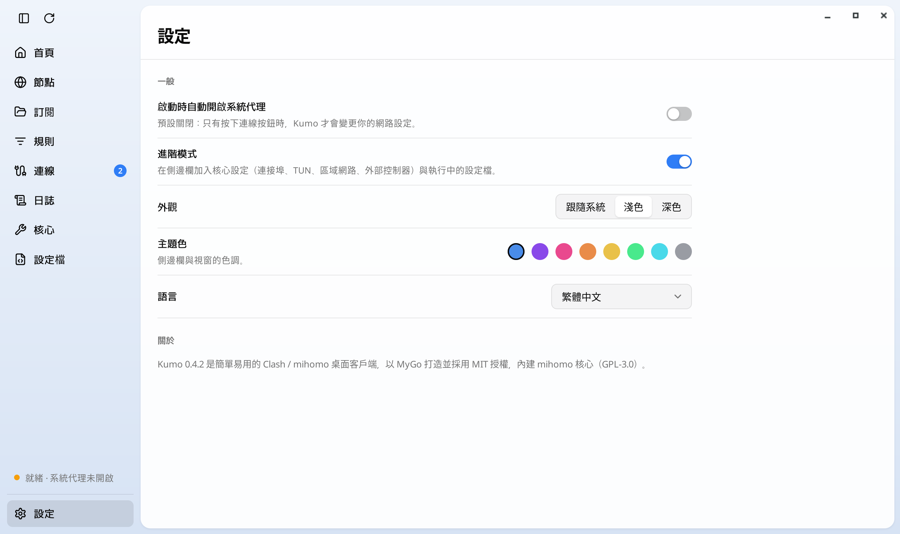<br>**Settings** — launch behavior, advanced mode, appearance |
| 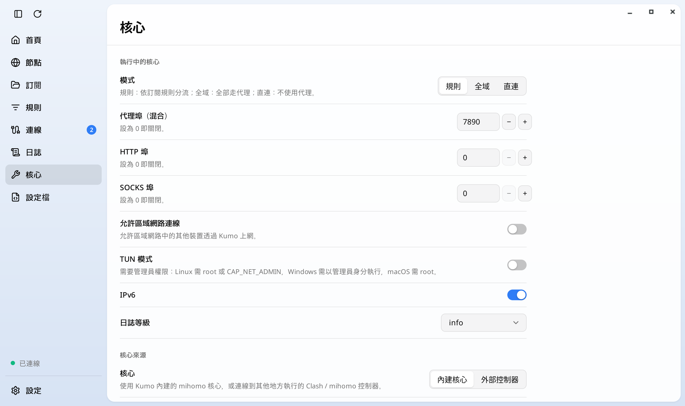<br>**Advanced mode › Core** — ports, LAN, TUN, IPv6, log level, source | 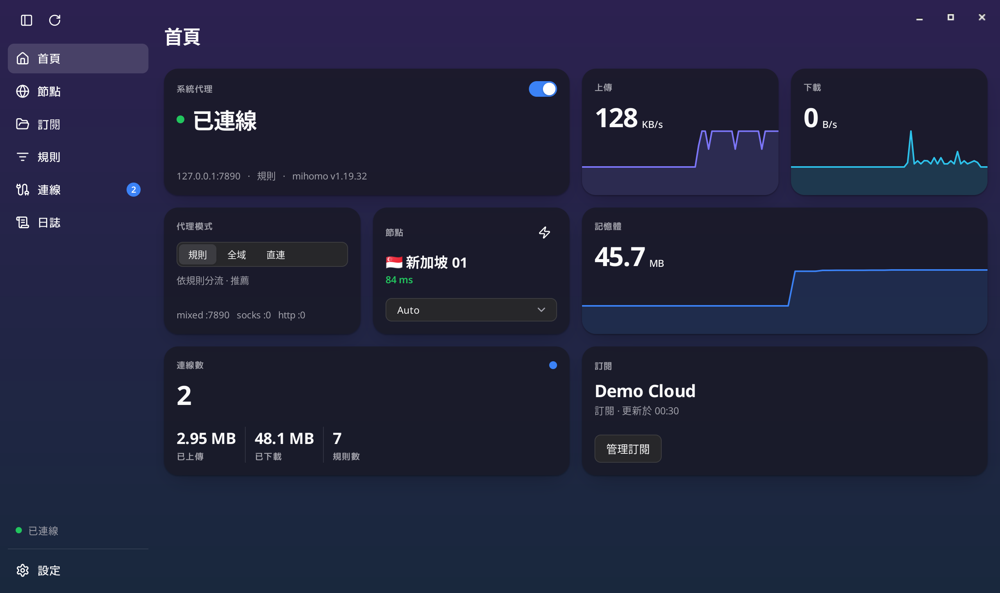<br>**Dark theme** |
| 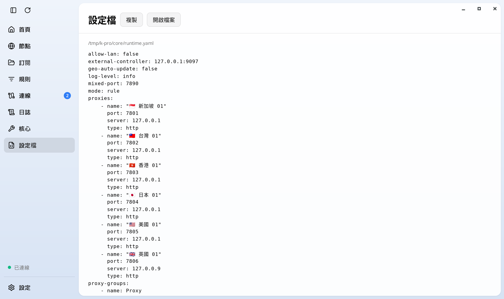<br>**Advanced mode › Configuration** — the running config, copyable | 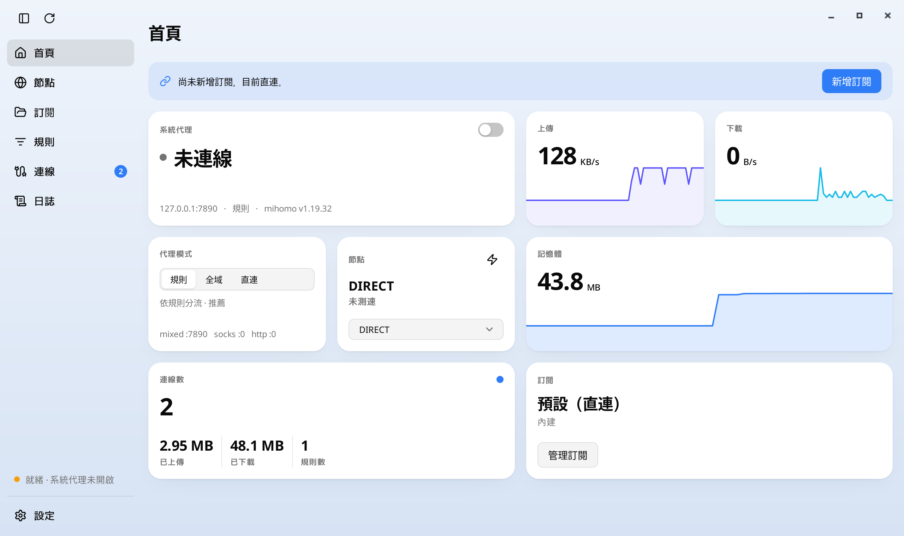<br>**First run** — a slim hint until a subscription is added |

## Download & install

Get the latest build from [Releases](https://github.com/kumo-app/kumo/releases/latest).
`SHA256SUMS` lists the checksum of every file.

| Platform | File | Notes |
|---|---|---|
| macOS (Apple Silicon & Intel) | `Kumo-<version>.dmg` or `Kumo-<version>-macos-universal.app.zip` | Drag Kumo to Applications. |
| Windows 10/11 (x64) | `Kumo-Setup-<version>-amd64.exe` or `Kumo-<version>-windows-amd64-portable.zip` | Installer, or unzip and run `Kumo.exe`. |
| Linux (x64 / arm64) | `kumo_<version>_<arch>.deb` or `kumo-<version>-linux-<arch>.tar.gz` | `sudo apt install ./kumo_*.deb`. The system proxy switch needs GNOME. |

The builds are **not code-signed**:

- **macOS:** the first time, right-click Kumo › **Open** › **Open**, or run
  `xattr -dr com.apple.quarantine /Applications/Kumo.app`.
- **Windows:** if SmartScreen appears, click **More info** › **Run anyway**.

## Quick start

1. **Add a subscription.** Open **Subscriptions**, paste your provider's
   Clash subscription link and press **Add** (or **Import file…** for a local
   YAML). It is used immediately.
2. **Connect.** On **Home**, turn on **System proxy**. Browsers and apps now
   go through Kumo; turn it off to disconnect. It stays off at launch unless
   **Settings › Turn on the system proxy at launch** is on.
3. **Pick a mode.**
   - **Rule** (recommended) — the subscription's rules decide what is proxied.
   - **Global** — everything goes through the selected node.
   - **Direct** — nothing is proxied.
4. **Choose a node** on Home (⚡ switches to the fastest), or on **Nodes**
   test all and pick one.

The tray (menu bar on macOS) shows the status and toggles the system proxy
and the mode. Closing the window keeps Kumo in the tray; **Quit Kumo** (or
⌘Q) stops the core and restores your proxy settings.

## Advanced mode

**Settings › Advanced mode** adds two pages:

- **Core** — mixed/HTTP/SOCKS ports, allow LAN, TUN, IPv6, log level; the
  core source (bundled, or an external controller with host, port and
  secret); status, version, binary, log and restart; latency test URL and
  timeout.
- **Configuration** — the YAML the core is running (your subscription plus
  Kumo's overrides), read-only, with Copy and Show file.

Shortcuts: **⌘R / Ctrl+R** refreshes, **⌘, / Ctrl+,** opens Settings.

**Enhanced Mode** (TUN) routes every app through Kumo, including those that
ignore the system proxy. Turn it on with the switch on the home screen, from
the tray or Dock menu, or on the Core page. The first time, Kumo asks once
for an administrator:

- **macOS** — after one password prompt, a launchd helper
  (`app.kumo.tun.<uid>`) runs the core as root, only while Kumo asks it to,
  in a root-owned folder of its own (`/Library/Application Support/Kumo`).
  Kumo hands it the configuration; the helper refuses one that opens
  listeners. The root core's controller is only a unix socket in that
  folder; Kumo reaches it through a filter (a root-owned copy of Kumo)
  on 127.0.0.1 that wants the secret and refuses configurations that open
  listeners, loads from a path, other PATCHes than Kumo's own, core
  upgrades and debug endpoints, so even a program holding the secret
  cannot open ports as root. The helper serves only the Kumo build that
  installed it, checked by its code signature (cdhash) on the running
  process; for an unsigned build only the process name is checked.
- **Linux** — `pkexec` copies the core to `/usr/local/lib/kumo/<uid>/`,
  runnable only by you (private group or an ACL; needs `setfacl` otherwise),
  with `cap_net_admin` and `cap_net_bind_service` (needs polkit and libcap).
  The polkit dialog names the program `/bin/sh`; Kumo explains first what it
  installs. No controller filter is needed: the core runs as you, and you
  could already run such a core yourself.
- **Windows** — run Kumo as administrator; mihomo brings its own wintun.
  With a separate administrator account (“over the shoulder”), Kumo then
  runs as that account: the system proxy and settings are that account's,
  not yours. Prefer running Kumo elevated from your own account.

Only the core Kumo ships is privileged: its SHA-256 is pinned in Kumo
(`corepin`, from `scripts/fetch-core/core.lock.json`) and checked by root on
a root-owned copy, so an update of Kumo or its core asks again. A core on
`PATH` never is. Turning Enhanced Mode off restarts the core without any
privilege. Kumo 0.4.3's world-runnable copy (`/Library/Application
Support/Kumo/mihomo` setuid, `/usr/local/lib/kumo/mihomo`) is offered for
removal at launch. To remove the helper on macOS: `sudo launchctl bootout
system/app.kumo.tun.$(id -u)`, then delete the plist in
`/Library/LaunchDaemons` and `/Library/Application Support/Kumo`.

On macOS, right-click the Dock icon for a quick menu: system proxy, Enhanced
Mode, mode, and a submenu per proxy group to switch node or use the fastest.

## Build from source

Requires Go 1.27+. No cgo; every platform cross-compiles from any host.

```sh
go run ./scripts/fetch-core            # the pinned mihomo core for this machine
go tool mygo build                     # package for this platform into build/
go tool mygo build -platform linux/amd64,windows/amd64,darwin/universal
go tool mygo dev                       # run with live reload
go test ./...
```

The core version and SHA-256 digests are pinned in
`scripts/fetch-core/core.lock.json`. `KUMO_DATA` sets the data directory and
`KUMO_PAGE` the start page (e.g. `/nodes`). The `.dmg` and the Windows
installer are built on macOS and Windows CI runners.

## Project structure

| Path | Contents |
|---|---|
| `clash/` | Controller client (REST + WebSocket) |
| `core/` | Runs the bundled core, builds its runtime config, manages subscriptions |
| `stats/` | Traffic statistics: per day/month, app, node and group, one gzip JSON file |
| `monitor/` | Session node monitor: latency samples, outages, uptime (memory only) |
| `nodetest/` | Per-node download speed and UDP checks through the test listener |
| `sysproxy/` | System proxy for macOS, Windows and Linux, with backup and restore |
| `main.go`, `state.go`, `engine.go`, `tray.go` | App start, live state, core and proxy lifecycle, tray and menus |
| `shell.go`, `look.go`, `chart.go` | Window layout, visual style, charts |
| `page_*.go` | One file per page |
| `lang.go`, `lang_zh.go` | Translations |
| `scripts/` | Core fetcher, screenshots, quit test |

## Acknowledgements

- [MyGo](https://github.com/egoist/mygo) (MIT) — the native Go UI framework
  Kumo is built on.
- [mihomo](https://github.com/MetaCubeX/mihomo) (GPL-3.0) — the bundled proxy
  core.
- [Lucide](https://lucide.dev) (ISC) — icons.

See [THIRD_PARTY_NOTICES.md](THIRD_PARTY_NOTICES.md) for every bundled
component.

## License

Kumo is released under the [MIT License](LICENSE). The mihomo core shipped
inside the packages is a separate program under GPL-3.0; it runs as its own
process, and its license and source link are included in every package
(`core/LICENSE-mihomo.txt`).
